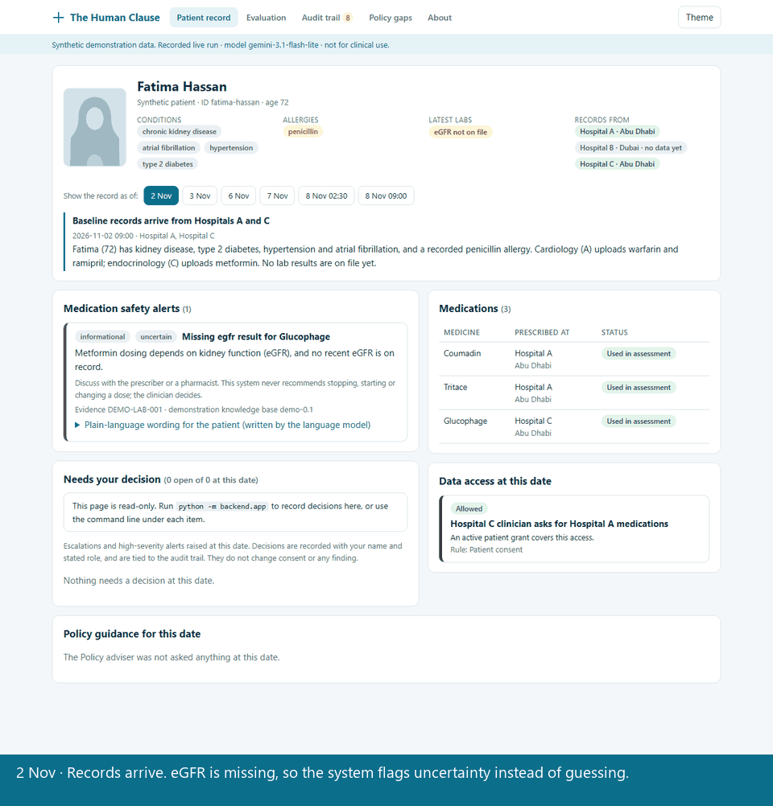
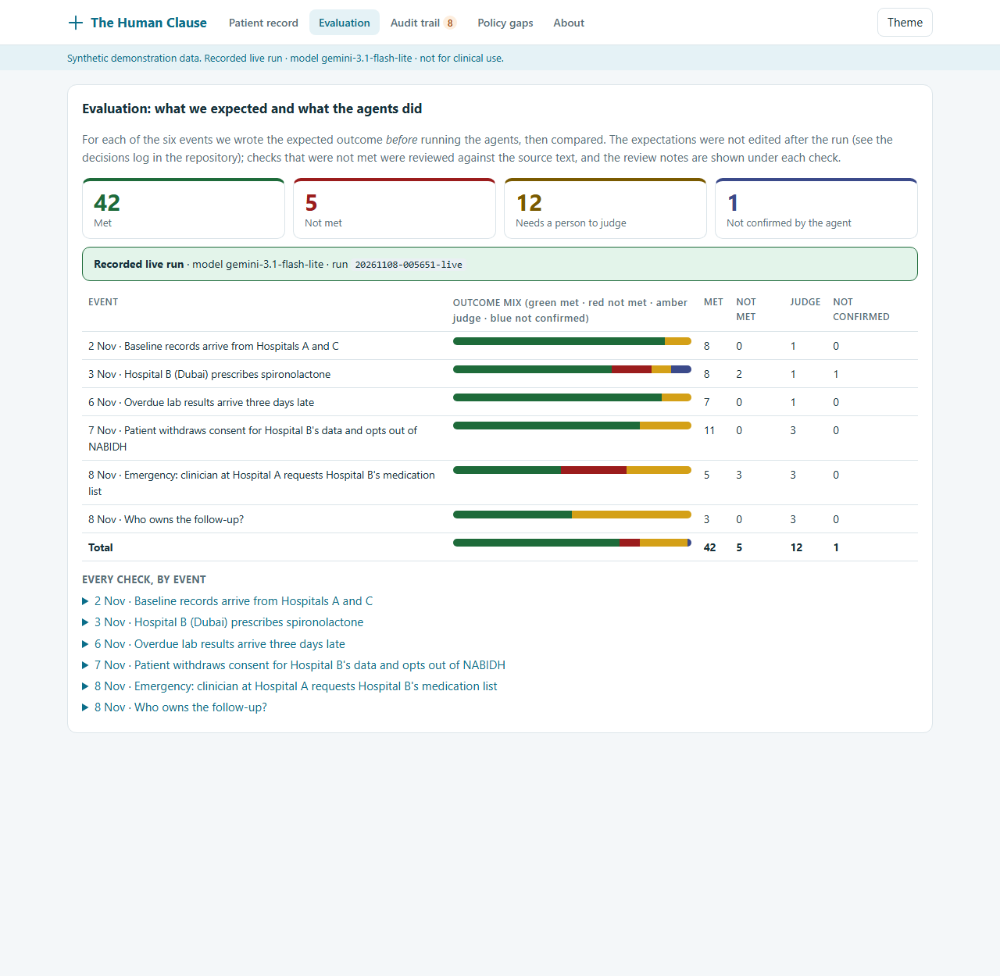
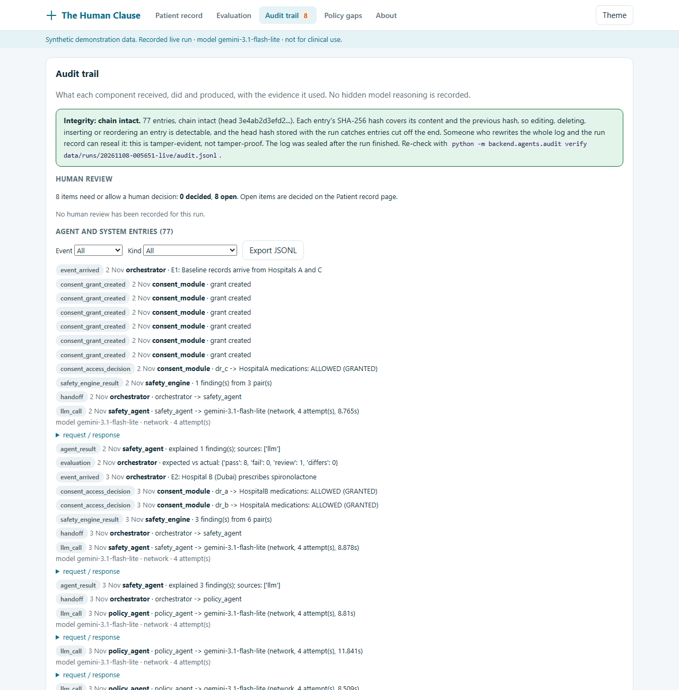
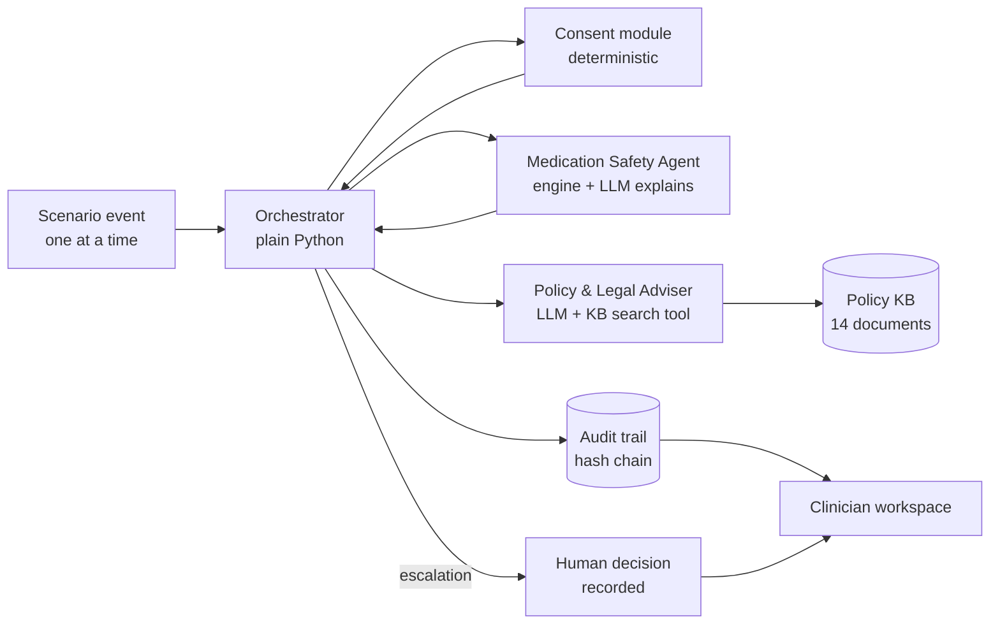

# The Human Clause

**Medication-safety AI agents that check what the law and the patient's consent allow before they act.**
Built for the [ITU AI for Good Lab Hackathon: United Arab Emirates (2026)](https://aiforgood.itu.int/event/ai-for-good-sandbox-hackathon-united-arab-emirates/).



*The animation steps through the six dates of the synthetic "Fatima Hassan" case. The decision shown in the sixth frame is illustrative and is not stored in the committed run.*


## The idea

A patient's medicines often come from several hospitals, sometimes in different emirates with different rules. When they meet, two questions arise at once:

1. **Is there a safety problem?** (an interaction, or a drug that is unsafe at the patient's kidney function)
2. **Is anyone allowed to look at, or act on, the data that reveals it?** (consent, withdrawal, opt-out, emergency access, which emirate's rules apply)

The Human Clause answers both. Where the rules are silent, conflict or leave responsibility unclear, it says so, and that becomes a **policy gap** with evidence. Decisions the rules cannot settle are escalated to a person and recorded.

## See it in 30 seconds

No installation and no API key are needed to look at it:

- Open [`docs/demo/index.html`](docs/demo/index.html) in a browser. This is the clinician workspace on a recorded live run. It is read-only and calls no model.
- Use **Show the record as of** to move through the six events of the "Fatima Hassan" case and watch the alerts, medicines and data-access decisions change as information arrives.

| Evaluation: expected vs actual | Audit trail with integrity check |
| --- | --- |
|  |  |

## Where each judging criterion is answered

| Criterion | What we built | Evidence |
| --- | --- | --- |
| **Knowledge-base quality** | 14 open documents (859 chunks): UAE federal law, Dubai DHA, Abu Dhabi DoH, EU comparators, ITU frameworks. Every chunk keeps document, section, page, official URL and retrieval date. | [`kb/MANIFEST.md`](kb/MANIFEST.md), [retrieval evaluation](docs/report/retrieval-eval.md) |
| **Agent capability** | Three agents with written mandates, tested on a six-event progressive scenario with expected outcomes written first. | [`docs/agents.md`](docs/agents.md), [`docs/report/evaluation.md`](docs/report/evaluation.md) |
| **Policy and standards gaps** | Four gaps (G1 to G4), each backed by full-text scans of the ingested texts, with caveats and an international comparison. | [`docs/report/gap-report.md`](docs/report/gap-report.md) |
| **Auditability** | Append-only, hash-chained audit trail; every policy claim cites a passage the agent actually retrieved; human review decisions are recorded with name, stated role and reason. | [Audit integrity](#audit-integrity), [Human review](#human-review) |
| **ITU alignment** | Components mapped to ITU-T Y.3172 pipeline nodes, and to the AI Readiness Framework 2.0 factors and dimensions. | [`mapping-y3172.md`](docs/report/mapping-y3172.md), [`mapping-ai-readiness.md`](docs/report/mapping-ai-readiness.md) |

The 5-page technical report on the official template is [`docs/report/The-Human-Clause-technical-report.docx`](docs/report/The-Human-Clause-technical-report.docx).

## How it works



| Component | Location | Role |
| --- | --- | --- |
| Orchestrator | `backend/agents/orchestrator.py` | Plain Python, deterministic (no LLM, no agent framework). Routes events, collects independent assessments, logs every handoff. |
| Medication Safety Agent | `backend/agents/safety_agent.py` | Calls the deterministic engine. The LLM only explains findings, is validated, and falls back to engine text. It never invents clinical facts. |
| Policy & Legal Adviser Agent | `backend/agents/policy_agent.py` | Searches the policy KB, returns requirements with citations, flags conflicts and unclear mandates. Citations must come from passages retrieved in that run. |
| Safety engine | `backend/safety/` | Interactions, duplication, contraindications, eGFR-aware flags, missing-data handling. Unit-tested. |
| Consent module | `backend/consent/` | Grants with scope and expiry, revocation, exchange opt-out, break-the-glass with escalation. Called as a tool, not an agent. |
| Policy KB + retrieval | `kb/`, `backend/kb/` | Chunked documents with BM25 retrieval. |
| LLM layer | `backend/llm/` | Provider-agnostic (free Gemini tier used), mock and live modes, on-disk response cache. |
| Audit trail | `backend/agents/audit.py` | Events, inputs, citations, rule checks, decision summaries. It records no hidden chain-of-thought. |
| Human review | `backend/review/` | Record-only decisions on escalations and high-severity alerts. |
| Clinician workspace | `backend/viewer/`, `backend/app/` | The interface (see below). |
| Report generator | `backend/report/` | Gap report, ITU mappings and the Word report, built from the recorded run. |

Each agent's authority and information boundary is in [docs/agents.md](docs/agents.md).

### The scenario

Six events are released one at a time, and the agents see only what has arrived:

1. Prescriptions from two hospitals in Abu Dhabi enter the record. Metformin cannot be assessed without eGFR.
2. A Dubai hospital adds spironolactone. The safety agent flags an interaction, and the policy agent says what may be shared under which regime.
3. Overdue lab results arrive three days late, and earlier uncertainty becomes concrete alerts.
4. The patient withdraws consent for the Dubai hospital and opts out of its exchange. The assessment becomes incomplete, and says so.
5. An emergency clinician requests break-the-glass access. A federal health-and-safety exception conflicts with Dubai's opt-out rule, so the system escalates and does not silently choose.
6. Nobody clearly owns the follow-up across three prescribers in two emirates, and that is logged as a policy gap.

## Results

The recorded live run is [`data/runs/20261108-005651-live`](data/runs/20261108-005651-live):

| Met | Not met | Needs a person to judge | Not confirmed by the agent |
| --- | --- | --- | --- |
| 42 | 5 | 12 | 1 |

- Expected outcomes were written **before** the agents existed and were not edited after the run. Every check that was not met is reviewed against the source text in `backend/report/content.py`, where our review judged the agent's alternative citations valid and our expectations too narrow.
- The first live run scored 41 / 6 / 11 / 2. We found three real causes (a negation-blind safety filter, a search tool that truncated passages, an agent that concluded "not found" after one search) and fixed them generically, without changing any expectation.
- The run was served entirely by `gemini-3.1-flash-lite`, because the primary model's free daily quota (20 requests) was spent. Mock-mode results are labelled as mock and never used as evidence.
- **Retrieval:** on 20 realistic questions, the expected passage was in the top 5 for 70% of questions without a filter and 75% with the jurisdiction scope the agent normally sets (expected document: 90% and 100%). Misses are mostly vocabulary gaps (for example "cloud server in another country" versus "outside the State"), and the agent mitigates them by searching several times. The questions were written by us and the sample is small, so treat this as an honest indication, not a benchmark. Details: [retrieval-eval.md](docs/report/retrieval-eval.md).

## Quick start

Requires Python 3.13. On Windows, if `python` opens the Microsoft Store, use `py -3`.

```powershell
pip install -r backend/requirements.txt pytest
python -m pytest backend/tests                 # offline, no API key; 135 tests
python -m backend.app                          # clinician workspace at http://127.0.0.1:8000
```

`python -m backend.app` serves the same page as the offline file and adds a form to record human review decisions. It binds to localhost only, needs no extra packages, and calls no model.

Re-run the scenario with no network (mock mode replays the cache; otherwise the agents fall back):

```powershell
copy .env.example .env
python -m backend.run_scenario --mode mock
```

Runs are written to `data/runs/<timestamp>-<mode>/` as `audit.jsonl`, `run.json` and `report.md`.

## The clinician workspace

Built for **clinicians**: one patient's record, the safety alerts, what data may be used and why, and the decisions only a person can make.

- **Patient record:** patient banner (placeholder silhouette, no photo), conditions, allergies, labs and sources, with a date selector that replays how the record changed as information arrived.
- **Alerts:** medication-safety findings, highest severity first, with the evidence reference. The language model's patient-worded text is in a labelled drop-down. The page never recommends stopping or changing a dose.
- **Medicines and data access:** who prescribed what, what is withheld because the patient withdrew consent, and why each access request was allowed or denied, with the rule.
- **Needs your decision:** escalations and high-severity alerts, with uphold, override or defer.
- **Policy guidance:** what the rules say for that situation, with expandable cited source text.
- **Evaluation, Audit trail, Policy gaps, About:** expected vs actual checks, the audit trail with integrity check and JSONL export, the gap report, and the prototype's limits.

Rebuild the page after a new run with `python -m backend.viewer.build_viewer`.

### Audit integrity

Every `audit.jsonl` is written as a hash chain: each entry's hash covers its content and the previous hash.

```powershell
python -m backend.agents.audit verify data/runs/20261108-005651-live/audit.jsonl
```

This detects edited, deleted, inserted or reordered entries. The head hash is also stored in `run.json`, so entries cut off the end are detected too. Someone who rewrites both files can reseal them, so it is **tamper-evident, not tamper-proof**, and the committed run was sealed after it finished. `seal` adds hashes to an older unsealed file.

### Human review

Escalations and high-severity findings stop at "a human must decide". A person can record that decision with their name, stated role and a reason, in the workspace (local app) or on the command line:

```powershell
python -m backend.review list   --run data/runs/20261108-005651-live
python -m backend.review record --run data/runs/20261108-005651-live --item E5:escalation:ED_btg_B_meds `
    --decision override --reviewer "Name" --role clinician --reason "At least 15 characters of reasoning"
python -m backend.review show   --run data/runs/20261108-005651-live
```

Decisions are `uphold`, `override` (also how an appeal is recorded) or `defer`. They are saved to `reviews.jsonl` as a hash chain tied to the run's audit trail. This is **record-only**: it changes no consent state or finding, the role is not verified, and there is no authentication. `reviews.jsonl` is git-ignored so local testing does not alter the committed run.

## Live mode

Edit `.env` and set `LLM_MODE=live`, `LLM_PROVIDER`, `LLM_API_KEY` and `LLM_MODEL` (see `.env.example`). Never commit `.env`.

```powershell
python backend/scripts/llm_smoke_test.py      # check structured output and tool calling
python -m backend.run_scenario --mode live    # real agents; responses are cached
```

To replay the committed recorded run offline, keep `LLM_MODEL=gemini-3.5-flash`. The cache key includes the configured primary model name, so changing it invalidates the cache.

## Rebuild the knowledge base, evaluation and report

```powershell
python backend/kb/ingest.py                   # raw documents -> kb/chunks/
python -m backend.kb.eval_retrieval --write docs/report/retrieval-eval.md
python -m backend.report.build                # report material -> docs/report/
npm install docx --no-save
python -m backend.report.export_docx          # -> docs/report/The-Human-Clause-technical-report.docx
```

The report build fails if any citation phrase is missing from the ingested KB.

## Roadmap: patient application (not built)

The same consent module, audit chain and review records are designed to serve a patient-facing app next to the clinician workspace:

- **Consent dashboard:** who can see which categories of data (medications, labs, allergies, conditions), for what purpose and until when, with grant, revoke and exchange opt-out controls that call `backend/consent/`.
- **Access history:** every access request and decision (including emergency "break-the-glass" access) in plain language, read from the audit trail.
- **Patient-facing explanations:** the plain-language wording the Safety agent already produces, shown with a clear "talk to your doctor or pharmacist" message and no dose advice.
- **Appeals and objections:** a patient can object to an access or a finding, using the review records (an override is how an appeal is recorded). This needs a real authority and identity model, which is an open policy gap (G2, G3).
- **Regulator view:** the gap report and audit integrity checks for a health authority or auditor.

None of this is built. It would need authentication, identity verification, secure storage, and clinical and legal review before real use.

## Limitations (not built)

- **Interface:** a clinician workspace over a recorded run (a static page, or a small local Python server that only records review decisions). No FastAPI service or React app, no live agent runs from the UI, and no patient-facing app.
- **Clinical content:** the safety knowledge base is a small demonstration set (4 interactions, 2 contraindications, 2 lab rules, 13 ingredients), unverified by a clinician or pharmacist.
- **Policy sources:** English text only (Arabic prevails legally). Some sources may be superseded (for example the 2020 Abu Dhabi HIE policy). Abu Dhabi's AI policy and Responsible AI Standard could not be downloaded, and Ministerial Decision 51 of 2021 is not ingested. Retrieval is keyword-based (BM25), with the vocabulary gaps noted above.
- **Security:** no authentication, encryption or protected storage. The audit log is tamper-evident, not tamper-proof.
- **Compliance:** independent validation, appeals and an accountability agreement (DHA AI policy 4.2 to 4.4) are not met.
- **Model:** free-tier language model; the recorded run was served by the fallback model.
- No federated learning, adherence reminders or real hospital integrations.

## Repository guide

| Path | What is there |
| --- | --- |
| `backend/` | All code: agents, safety engine, consent, KB, LLM client, scenario, review, viewer, app, report, tests |
| `kb/` | The policy knowledge base: `MANIFEST.md`, `raw/` source files, `chunks/` |
| `data/runs/` | Recorded runs: `run.json`, `audit.jsonl`, `report.md` |
| `data/llm_cache/` | Recorded model responses, so the run replays offline |
| `docs/demo/` | The offline clinician workspace page |
| `docs/report/` | Technical report, mappings, gap report, evaluation, retrieval evaluation |
| `docs/agents.md`, `docs/decisions.md` | Agent mandates and the running decisions log |

## Sources and licensing

The knowledge base holds public government and standards documents, kept with their official URLs in [kb/MANIFEST.md](kb/MANIFEST.md). Copyright in those documents remains with their issuers; they are included for research and demonstration, and Arabic originals prevail legally. The code in this repository has no licence file yet; add one before reuse.
